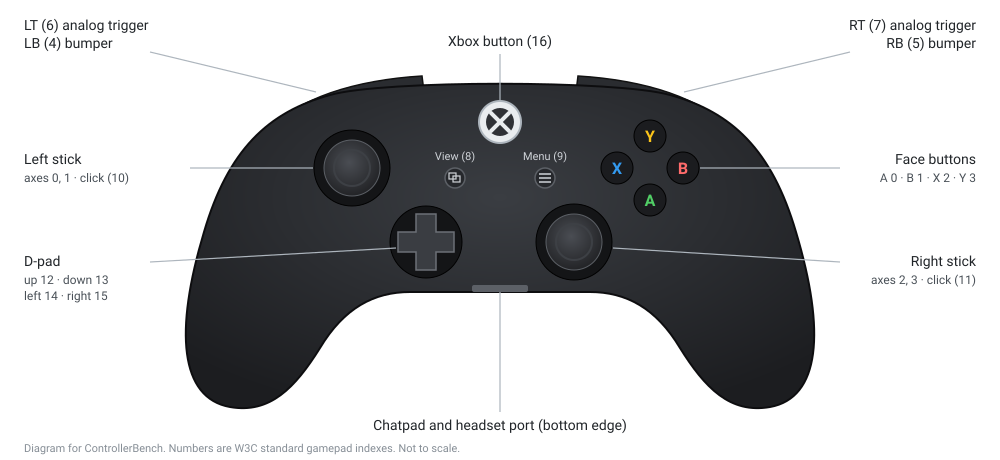
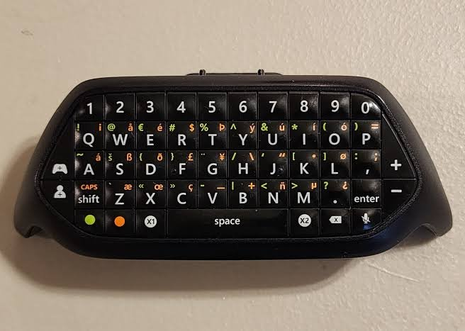

# Xbox_ControllerBench

Browser-based tester for Xbox One controllers (USB-C or Bluetooth) and USB
keyboards. Runs in Chrome via npm. Live stick, trigger and button readout,
drift and deadzone checks, rumble test, keyboard rollover, ghosting and key
chatter tests. Software calibration only. Nothing is written to device firmware.

**Version:** v3 (USB-C controller, Xbox chatpad, keyboard). Bluetooth comes later.

Works with the controller, with the chatpad plugged into the controller, or
with both together.

| Xbox One controller | Xbox chatpad |
|---|---|
|  |  |
| Every button, both sticks and both triggers. Extra buttons the controller reports show as extra tiles. | Every key, including +, -, X1, X2, green, orange, mic and the two icon keys. |

## Compatibility

| Device | Status |
|---|---|
| Xbox One controller, USB-C, Windows 10/11, Chrome | Tested (v1 report): standard mapping, 17 buttons, 4 axes, rumble API present. |
| Xbox chatpad on that controller, Windows | Partly tested: letters, digits and Alt-code symbols reach the browser. Special keys: learn them in the Chatpad layout. |
| Xbox Series X\|S, Xbox 360, Xbox Elite controllers | Expected to work through the same Windows driver. Unverified. Elite back paddles are usually not reported to the browser (unverified). |
| PlayStation DualShock 4 and DualSense, Switch Pro Controller | Expected to work if Chrome reports `mapping: standard`. Unverified. Button names on the page use Xbox names (A = Cross, B = Circle, X = Square, Y = Triangle). |
| Any other gamepad | Use the **Raw inputs** panel. Every axis and button shows by index. |
| Any USB or wireless keyboard | Full keyboard layout. Keys not on the layout show under **Other keys**. |

The chatpad's Alt-code symbols (green or orange + a letter) work only on
Windows. Bluetooth is not tested yet (issue 3).

## Requirements

- Node.js 18 or newer. No npm packages to install.
- Google Chrome (or Microsoft Edge). Other browsers are not tested.
- Xbox One controller and a USB-C **data** cable.

## Start

1. Open a terminal in this folder.
2. Run the server:

   ```bash
   npm start
   ```

3. Open `http://127.0.0.1:3100/` in Chrome.
4. Connect the controller with the USB-C cable.
5. Press any button on the controller.

Notes:
- Chrome shows a controller to the page only after a button press.
- A charge-only cable does not carry data. The controller will not show.
- Use `127.0.0.1` or `localhost`. Chrome blocks the Gamepad API on a plain
  `http://` LAN address (for example `http://192.168.x.x`).
- To use another port: `PORT=3101 npm start` (Linux/macOS) or
  `set PORT=3101 && npm start` (Windows cmd).

## Controller tests (Controller tab)

1. Check the **Controller** card. It shows the name, mapping, axes, buttons,
   input updates per second and rumble support. On Windows, input updates
   read 0 while nothing moves. That is normal. Yellow warnings mean Chrome did not
   map the controller as standard. Use **Raw inputs** in that case.
2. **Buttons:** press every button once. The counter goes to 16 / 16.
   - Note: the Xbox button is optional. Some systems keep it from the browser.
     On Windows it can also open Game Bar.
3. **Drift test:** put the controller flat. Do not touch it. Press
   **Start drift test**. Result `Drift` means the rest offset is above your
   warning limit (default 0.05, your value, not a factory spec). The result
   also says if the offset is inside the Windows XInput default deadzone
   (xinput.h: left 0.240, right 0.265). Most Windows games ignore movement
   inside that radius.
4. **Range test:** press **Start range test**. Turn both sticks slowly against
   the edge for 3 full circles. Press **Stop**. The blue outline shows the
   edge each stick reached.
5. **Trigger range:** press **Start trigger test**. Release, then fully press
   each trigger a few times. Press **Stop**.
6. **Rumble:** set the motor strength and duration. Press a rumble button.
   Duration is capped at 1000 ms.

## Software calibration

1. Run the drift test, then the range test, then the trigger test.
2. Press **Use test results**.
3. Check the values in the table.
4. Press **Save**.

Notes:
- Calibration changes only how this page reads the controller. Nothing is
  sent to the controller. Other games and apps do not see it.
- Values are stored in this browser, per controller name.
- **Export JSON** and **Import JSON** move values between browsers.
- Inner deadzone suggestion = largest resting wobble + 0.02. Outer edge
  suggestion = shortest edge radius from the range test. These are a starting
  point. Edit them as needed.

## Chatpad tests (Keyboard tab, layout "Xbox chatpad")

1. Plug the chatpad into the bottom of the controller.
2. Connect the controller to the PC.
3. Open the **Keyboard** tab. Set **Layout** to **Xbox chatpad**.
4. Press every key on the chatpad. Tested keys turn green.
5. For each dashed key (+, -, X1, X2, green, orange, mic, Pad icon, People icon):
   1. Click the key on screen.
   2. Press the same key on the chatpad.
   3. If the page shows nothing, click **No event**.
6. Check the counter. It reaches 51 / 51 when every key is pressed or marked.

Notes:
- Learned keys are saved in this browser. **Reset learned keys** clears them.
- A key that is "No event" is handled by Windows or the chatpad itself and
  never reaches the browser (for example a mic mute key). Unverified per key.
- Green or orange + a letter types a symbol as a Windows Alt code. The symbol
  shows under **Alt codes**.
- You can click any key on screen to learn it again.

## Keyboard tests (Keyboard tab)

1. Open the **Keyboard** tab and click in the page.
2. Press every key. Tested keys turn green.
3. **Rollover:** hold keys down one at a time. Watch **Max held at once**.
   If a held key does not light up, the keyboard dropped it.
4. **Chatter:** tap each key once at normal speed. A red outline means one tap
   was seen as two presses within the chatter limit (default 30 ms).
5. **Full screen + capture system keys** lets Chrome capture keys such as Win
   and Alt+Tab. Press and hold Esc to leave full screen.

Keys that are not on the standard layout (media keys, F13 to F24) show under
**Other keys**.

Some keyboards and chatpads type symbols as Windows Alt codes (Alt held,
digits on the numpad). These show under **Alt codes** and are not counted as
chatter. Alt codes work only on Windows.

## Diagnostics tab

- Browser checks: browser, platform, secure context, Gamepad API, rumble API,
  Keyboard Lock API, storage.
- Page errors: every script error on the page. Press **Copy errors** and send
  them in for a fix.

## Report

**Export report** downloads one JSON file with the controller results,
keyboard results, browser checks and page errors.

## Safety

- The server only serves files on `127.0.0.1`. It does not talk to any device.
- The page reads inputs with the Gamepad API and KeyboardEvent.
- The only output to the controller is rumble, through the browser's
  `vibrationActuator`, capped at 1000 ms.
- No firmware writes. No WebUSB or WebHID device writes.

## Develop

```bash
npm test
```

Tests cover the math (drift, range, calibration), the keyboard tracker and the
server. See [AGENTS.md](AGENTS.md) for the code map and rules.

## Roadmap

- Bluetooth connection (issue 3). Test Chrome mapping over Bluetooth on
  Windows and Linux. Fix any non-standard mapping.
- Desktop mode: use the controller and chatpad as mouse and keyboard on
  Windows, with a settings page. Desktop mode v1 is on the
  [`desktop-mode` branch](https://github.com/opsecfreak/Xbox_ControllerBench/tree/desktop-mode)
  (guide: `docs/DESKTOP.md` on that branch). Not tested on hardware yet.
