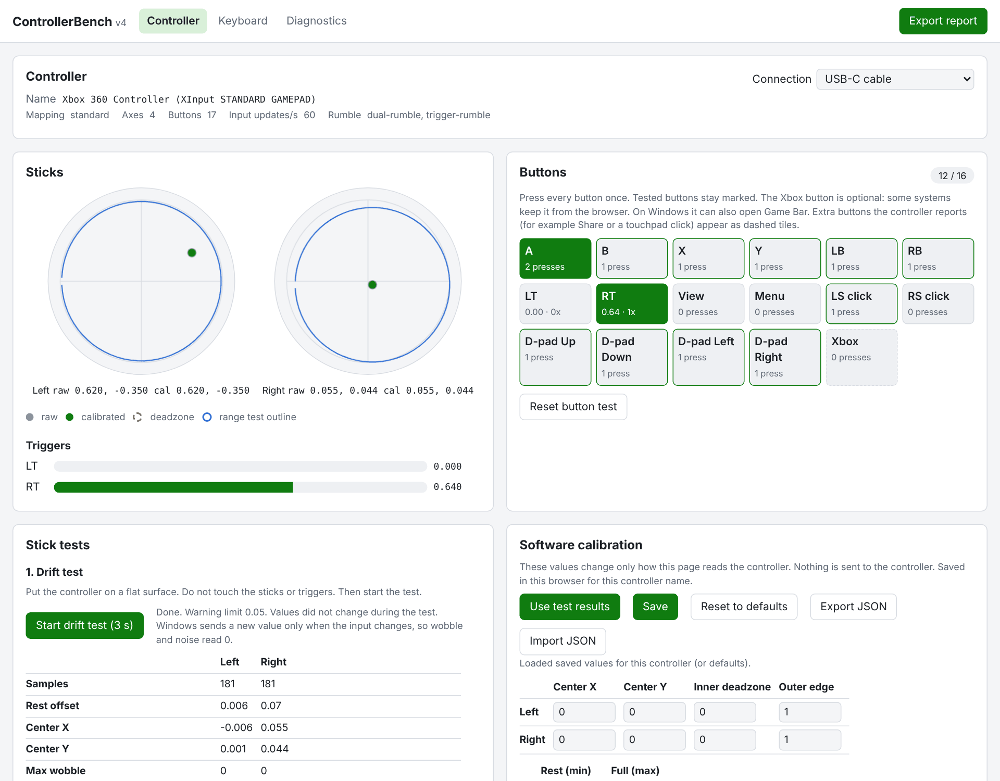
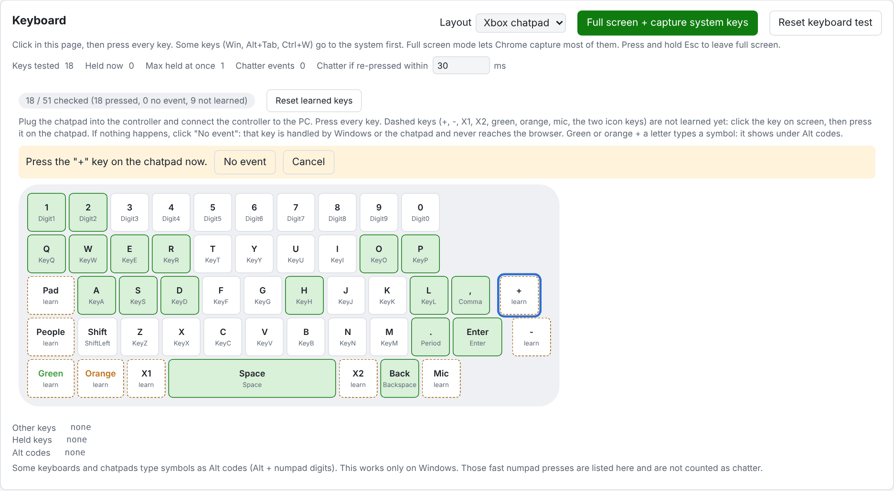

# Xbox_ControllerBench

[](https://github.com/opsecfreak/Xbox_ControllerBench/actions/workflows/test.yml)
[](https://github.com/opsecfreak/Xbox_ControllerBench/releases/latest)
[](LICENSE)

> **You are on the `desktop-mode` branch.** It has everything in the tester
> plus **desktop mode**: use the controller as a mouse and the chatpad as a
> keyboard on Windows. Desktop mode is a pre-release, not tested on real
> hardware yet. Guide: [docs/DESKTOP.md](docs/DESKTOP.md). The stable tester
> is on [`main`](https://github.com/opsecfreak/Xbox_ControllerBench).

**ControllerBench** tests an Xbox controller, the Xbox chatpad and any keyboard
in Chrome. Every button, both sticks, both triggers, rumble, stick drift, stick
range, key rollover and key chatter. It runs on your own PC, needs no install
beyond Node.js, and never writes anything to the controller.



| Xbox One controller | Xbox chatpad |
|---|---|
|  |  |
| Every button, both sticks and both triggers. Extra buttons the controller reports show as extra tiles. | All 51 keys, including +, -, X1, X2, green, orange, mic and the two icon keys. |

## Features

- **Live readout:** stick positions with raw and calibrated dots, trigger bars,
  button tiles with press counts, raw values for any gamepad.
- **Drift test:** rest offset, wobble and noise for each stick, compared with
  your limit and with the Windows XInput default deadzone.
- **Range test:** the edge each stick reaches in every direction, with a
  circularity figure.
- **Trigger range** and **rumble test** (dual motor and trigger motors, short
  pulses only).
- **Software calibration:** center, deadzone and edge per stick, trigger
  limits. Saved in the browser. Export and import as JSON.
- **Keyboard test:** full-size layout, rollover, ghosting, key chatter, Alt
  code decoding, event log, full screen key capture.
- **Chatpad test:** chatpad layout with every key. Unknown special keys are
  learned by click-then-press.
- **Diagnostics:** browser checks and a page error list you can copy.
- **Report:** one JSON file with every result, for a repair log or a bug report.

## Quick start

1. Install [Node.js](https://nodejs.org/) 18 or newer.
2. Download the [latest release](https://github.com/opsecfreak/Xbox_ControllerBench/releases/latest)
   and unzip it, or clone the repo:

   ```bash
   git clone https://github.com/opsecfreak/Xbox_ControllerBench.git
   ```

3. Open a terminal in the folder and start the server:

   ```bash
   npm start
   ```

4. Open `http://127.0.0.1:3100/` in Chrome or Edge.
5. Connect the controller with a USB data cable.
6. Press any button on the controller.

Notes:
- No `npm install` step. The project has no dependencies.
- Chrome shows a controller to a page only after a button press.
- A charge-only cable does not carry data. The controller will not show.
- Use `127.0.0.1` or `localhost`. Chrome blocks controller access on a plain
  `http://` LAN address such as `http://192.168.x.x`.
- Another port: `PORT=3101 npm start` (Linux, macOS) or
  `set PORT=3101 && npm start` (Windows cmd).

## Compatibility

| Device | Status |
|---|---|
| Xbox One controller, USB-C, Windows 10/11, Chrome | Tested: standard mapping, 17 buttons, 4 axes, rumble API present. |
| Xbox chatpad on that controller, Windows | Partly tested: letters, digits and Alt-code symbols reach the browser. Learn the special keys in the chatpad layout. |
| Xbox Series X\|S, Xbox 360, Xbox Elite controllers | Expected to work through the same Windows driver. Unverified. Elite back paddles are usually not reported to browsers (unverified). |
| PlayStation DualShock 4 and DualSense, Switch Pro Controller | Expected to work if Chrome reports `mapping: standard`. Unverified. The page uses Xbox names (A = Cross, B = Circle, X = Square, Y = Triangle). |
| Any other gamepad | Use the **Raw inputs** panel. Every axis and button shows by index. |
| Any USB or wireless keyboard | Full keyboard layout. Keys not on the layout show under **Other keys**. |
| Bluetooth connection | Not tested yet ([issue 3](https://github.com/opsecfreak/Xbox_ControllerBench/issues/3)). |

Tested a device that is not listed? Open a
[compatibility report](https://github.com/opsecfreak/Xbox_ControllerBench/issues/new?template=compatibility_report.md)
and attach the exported report JSON.

## Controller tests (Controller tab)

1. Check the **Controller** card: name, mapping, axes, buttons, input updates
   per second and rumble support.
   - Note: on Windows, input updates read 0 while nothing moves. That is normal.
   - Note: yellow warnings mean Chrome did not map the controller as standard.
     Use **Raw inputs**.
2. **Buttons:** press every button once. The counter goes to 16 / 16.
   - Note: the Xbox button is optional. Some systems keep it from the browser.
     On Windows it can open Game Bar.
3. **Drift test:** put the controller flat. Do not touch it. Press
   **Start drift test**.
   - Note: `Drift` means the rest offset is above your warning limit (default
     0.05: your value, not a factory spec). The result also says if the offset
     is inside the Windows XInput default deadzone (xinput.h: left 0.240,
     right 0.265). Most Windows games ignore movement inside that radius.
4. **Range test:** press **Start range test**. Turn both sticks slowly against
   the edge for 3 full circles. Press **Stop**. The blue outline shows the
   edge each stick reached.
5. **Trigger range:** press **Start trigger test**. Release, then fully press
   each trigger a few times. Press **Stop**.
6. **Rumble:** set the motor strength and duration. Press a rumble button.
   - Note: duration is capped at 1000 ms.

## Software calibration

1. Run the drift test, then the range test, then the trigger test.
2. Press **Use test results**.
3. Check the values in the table.
4. Press **Save**.

Notes:
- Calibration changes only how this page reads the controller. Nothing is sent
  to the controller. Games and other apps do not see it.
- Values are stored in this browser, per controller name. **Export JSON** and
  **Import JSON** move them between browsers.
- Suggested inner deadzone = largest resting wobble + 0.02. Suggested outer
  edge = shortest edge radius from the range test. Edit them as needed.

## Chatpad tests (Keyboard tab, layout "Xbox chatpad")



1. Plug the chatpad into the bottom of the controller.
2. Connect the controller to the PC.
3. Open the **Keyboard** tab. Set **Layout** to **Xbox chatpad**.
4. Press every key on the chatpad. Tested keys turn green.
5. For each dashed key (+, -, X1, X2, green, orange, mic, Pad icon, People icon):
   1. Click the key on screen.
   2. Press the same key on the chatpad.
   3. If the page shows nothing, click **No event**.
6. Check the counter. It reaches 51 / 51 when every key is pressed or marked.

Notes:
- Learned keys are saved in this browser. **Reset learned keys** clears them.
  Click any key on screen to learn it again.
- "No event" means Windows or the chatpad handles that key and the browser
  never sees it.
- Green or orange + a letter types a symbol as a Windows Alt code. The symbol
  shows under **Alt codes**. Alt codes work only on Windows.

## Keyboard tests (Keyboard tab, layout "Full keyboard")

1. Click in the page.
2. Press every key. Tested keys turn green.
3. **Rollover:** hold keys down one at a time. Watch **Max held at once**. If
   a held key does not light up, the keyboard dropped it.
4. **Chatter:** tap each key once at normal speed. A red outline means one tap
   was seen as two presses within the chatter limit (default 30 ms).
5. **Full screen + capture system keys** lets Chrome capture keys such as Win
   and Alt+Tab. Press and hold Esc to leave full screen.

Notes:
- Keys that are not on the layout (media keys, F13 to F24) show under
  **Other keys**.
- Alt + numpad digits are listed as Alt codes, not as chatter.

## Diagnostics and report

- **Diagnostics** tab: browser, platform, secure context, Gamepad API, rumble
  API, Keyboard Lock API and storage checks, plus every page error. Press
  **Copy errors** to paste them into an issue.
- **Export report** (top right): one JSON file with the controller results,
  keyboard and chatpad results, browser checks and page errors.

## Desktop mode (this branch, Windows, pre-release)

Use the controller as a mouse while the chatpad types.

1. Start the server with desktop mode on:

   ```bash
   npm run desktop
   ```

2. Move the left stick. The pointer moves.
3. Open `http://127.0.0.1:3100/desktop.html` to change settings.
4. Hold **View + Menu** for 1 s to pause before you start a game.

| Input | Default action |
|---|---|
| Left stick / right stick | Pointer / scroll |
| A / B | Left click (hold to drag) / right click |
| X / Y | Enter / Escape |
| LB / RB | Browser back / forward |
| LT (hold) | Slow, precise pointer |
| View / Menu (tap) | Task view / Start |
| D-pad | Arrow keys |

Every input can be changed. Full guide, safety notes and limits:
[docs/DESKTOP.md](docs/DESKTOP.md).

## Privacy and safety

- Everything runs on your PC. The server listens on `127.0.0.1` only. Nothing
  is uploaded. No analytics.
- Desktop mode sends mouse and key input to Windows only while it runs and is
  not paused. Its settings API answers only the page on the same PC.
- The page reads inputs with the browser Gamepad API and keyboard events.
- The only output to the controller is rumble, through the browser, capped at
  1000 ms.
- No firmware writes. No WebUSB, WebHID or WebSerial access.

## Troubleshooting

| Problem | Fix |
|---|---|
| "No controller seen yet" | Press a button on the controller. Use a data cable, not a charge-only cable. |
| Works on `localhost`, not from another PC | Chrome needs a secure context for gamepads. Run the server on the PC the controller is plugged into. |
| Xbox button does nothing | Normal on some systems. Windows can keep it for Game Bar. It is optional in the test. |
| A chatpad key does nothing | Click it on screen, press it, then click **No event** if nothing appears. |
| `Port 3100 is in use` | Start with another port: `PORT=3101 npm start`. |
| Something else | Open **Diagnostics**, press **Copy errors**, and open a [bug report](https://github.com/opsecfreak/Xbox_ControllerBench/issues/new?template=bug_report.md). |

## Develop and fork

```bash
npm test
```

- Plain Node.js (18, 20, 22) and browser ES modules. No build step, no
  dependencies, no framework.
- CI runs the tests on Linux and Windows with Node 18 and 22.
- Code map, hard rules and release steps: [AGENTS.md](AGENTS.md).
- How to contribute: [CONTRIBUTING.md](CONTRIBUTING.md).
- Change history: [CHANGELOG.md](CHANGELOG.md).

```
server.js               local static server (127.0.0.1)
public/index.html       the page (Controller, Keyboard, Diagnostics tabs)
public/js/              page modules; public/js/lib/ = pure logic with tests
public/desktop.html     desktop mode settings page
desktop/                desktop mode: engine, manager, Windows helper
docs/DESKTOP.md         desktop mode guide
docs/images/            README images
test/                   node --test suites
```

## License

[MIT](LICENSE). Xbox is a trademark of Microsoft. This project is not
affiliated with or endorsed by Microsoft.
